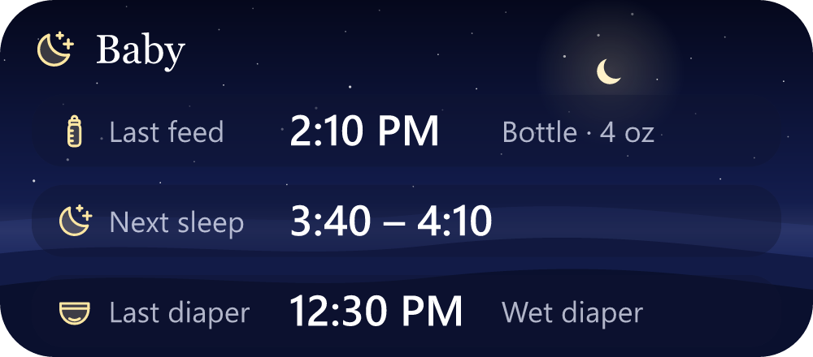

# LibreBaby

**A free, private baby tracker for Android.** Log sleep, feeds, diapers, pumping, medication and growth in a tap or two, see what's typical for your baby's age, and share it all with the other parent's phone over your home Wi-Fi. No account, no cloud, no ads, no tracking. Your data stays on your phones.

<p align="center">
  
</p>

## Features

**Logging**
- **Sleep and breastfeeding timers** that keep running with the app closed. A notification with a live clock shows while one runs. Breastfeeding tracks each side, and shows which side you used last without starting it automatically.
- **Bottles** (breast milk or formula, in oz or ml), **solids**, **diapers** (wet, dirty or both, in one tap), **pumping** (amount per side), **medication** (recent medicines re-log in one tap and show when they were last given) and **growth** (weight, length, head size).
- Enter anything after the fact, edit or delete any entry, and undo a quick log for a few seconds.

**Understanding**
- **Next sleep window:** an estimate of when your baby will be ready to sleep again. It starts from typical awake times for their age and adapts to your baby's own pattern.
- **Timeline** of each day with totals, and **Insights** with daily trends over 7, 14 or 30 days.
- **Growth charts** against the WHO Child Growth Standards (birth to 2 years), with the percentile for each measurement.
- **Development:** a short note for every week of the first year and every month to age three, plus the CDC's developmental milestone checklists (2 months to 3 years). Tick milestones off as they happen.

**Everyday**
- **Home-screen widget:** time since the last feed and diaper, and the next sleep window.
- **Optional reminders** shortly before the sleep window opens.
- **Time-of-day design:** "liquid glass" panels over a sky that follows the real sunrise and sunset. There's also an always-night option for 3 AM.

**Your data**
- **Family sync** between phones on the same Wi-Fi, end-to-end encrypted, with no server in between. Pair once by scanning a QR code. It keeps syncing in the background after that, and you can turn that off.
- **Backup and restore** to a single file you keep wherever you like, and **export everything as a spreadsheet (CSV)**.
- **Import from Huckleberry:** bring your history over from a Huckleberry CSV export.

## Privacy

LibreBaby has no accounts, no analytics, no ads and no servers. Everything you log is stored in a database on your phone, and leaves it only in these ways:

- **Family sync** sends entries directly to the phones you paired, over your local Wi-Fi. They're encrypted with a key only your family's phones have. Phones find each other on the local network and never connect over the internet. See [SYNC.md](SYNC.md) for how it works.
- **A backup or spreadsheet export** goes wherever you choose to share it.

**Why each permission:**

| Permission | Why |
|---|---|
| Camera | Scanning the family code (QR) when pairing a phone. Only used on that screen. |
| Approximate location | Optional: sunrise and sunset times for the sky. Rounded to about 10 km, stored only on the phone, and never synced or included in backups. Precise and background location are not requested. |
| Notifications | Sleep-window reminders, the running-timer notification, and the notification Android requires while background sync is on. |
| Internet, Wi-Fi and network state, Wi-Fi multicast | Family sync on the local network: finding the other phone and connecting to it. Android requires the "Internet" permission even for local connections. |
| Foreground service (connected device), run at startup, wake lock, ignore battery optimizations | Keeping family sync running while the app is closed. LibreBaby asks Android for the battery exemption only if you tap the button in Settings. |
| Vibrate | Gentle haptic feedback when you log something. |

The notifications library LibreBaby uses (expo-notifications) includes Google's Firebase messaging code, because it also supports push notifications. LibreBaby doesn't use push notifications and has no Firebase configuration, so that code is never set up and no push service is contacted.

## Install

LibreBaby is distributed as an APK (Android 7 and newer).

1. Download the latest `LibreBaby-x.y.z.apk` from the [Releases](../../releases) page.
2. Open it on your phone and allow installing from that source when Android asks.
3. To get updates automatically, add this repository to [Obtainium](https://github.com/ImranR98/Obtainium).

Every release is signed with the same key, so updates install over the previous version and keep your data. To check that an APK really comes from this project, run `apksigner verify --print-certs LibreBaby-x.y.z.apk` (from the Android SDK build tools) and compare the certificate's SHA-256 digest:

```
a6e03857597a26051ad2eddee8e69fc4a367f245241303ddde39d5e976245646
```

**Family sync** needs the same LibreBaby version (or at least the same sync protocol) on every phone. If they don't match, Settings › Family sync tells you which phone to update.

## Not medical advice

LibreBaby is a logging tool, not a medical device:
- Sleep windows, growth percentiles, weekly notes and milestones describe what's typical. Every baby develops at their own pace.
- Talk to your pediatrician about any concern, and don't wait if your baby seems unwell or has lost skills they once had.
- In an emergency, call your local emergency number.

## Sources and credits

- **Developmental milestones:** U.S. Centers for Disease Control and Prevention, ["Learn the Signs. Act Early."](https://www.cdc.gov/act-early/milestones/index.html) milestone checklists, developed with the American Academy of Pediatrics. U.S. government work, public domain. The wording is kept, with gendered pronouns made neutral.
- **Growth standards:** [WHO Child Growth Standards](https://www.who.int/tools/child-growth-standards), from the LMS data files [published by the CDC](https://www.cdc.gov/growthcharts/who-data-files.htm).
- **Weekly notes:** original text written for LibreBaby from widely published guidance (AAP, CDC, WHO).
- **Icons:** [Phosphor Icons](https://phosphoricons.com) (MIT), plus a few drawn for LibreBaby in the same style (bottle, diaper, pump, breast).
- **Sunrise and sunset:** the "Almanac for Computers" sunrise equation (U.S. Naval Observatory), computed on the phone.
- Built with [Expo](https://expo.dev) and React Native.

LibreBaby is an independent project, not affiliated with or endorsed by Huckleberry or any other baby-tracking app. The Huckleberry import only reads the CSV file that Huckleberry lets you export.

## Development

LibreBaby is an [Expo](https://expo.dev) app (React Native, TypeScript, Expo Router, SQLite).

```bash
npm install
npx expo start      # try most screens in Expo Go
npx tsc --noEmit    # typecheck
npx expo lint       # lint
npx jest            # tests
```

Expo Go can run most of the app, but not family sync, the widget, notifications or background sync, because those need LibreBaby's own native code. For those, build an APK: see [BUILDING.md](BUILDING.md).

| Where | What |
|---|---|
| `src/app/` | Screens (Expo Router: every file is a route) |
| `src/components/` | UI: glass panels, the sky, forms, charts |
| `src/db/` | SQLite schema, migrations and queries |
| `src/lib/` | Pure logic: sleep prediction, sun times, the sky, growth percentiles, Huckleberry parsing |
| `src/sync/` | Family sync: pairing, encryption, the sync protocol |
| `src/data/` | Milestones, weekly notes, WHO growth tables |
| `src/widget/` | The home-screen widget |
| `modules/` | Small native Android modules: the live-timer notification and widget refresh, and background sync |

Other docs: [SPEC.md](SPEC.md) (product scope), [SYNC.md](SYNC.md) (sync design and protocol), [BUILDING.md](BUILDING.md) (building and signing the APK).

Bug reports and ideas are welcome as issues. For a bigger change, please open an issue to talk it over first.

## License

Copyright (C) 2026 jjroth001

LibreBaby is free software: you can redistribute it and/or modify it under the terms of the GNU General Public License as published by the Free Software Foundation, either version 3 of the License, or (at your option) any later version. It is distributed in the hope that it will be useful, but WITHOUT ANY WARRANTY; without even the implied warranty of MERCHANTABILITY or FITNESS FOR A PARTICULAR PURPOSE. See [LICENSE](LICENSE) for the full text.

In short: you can use, study, change and share LibreBaby, including your own modified versions, as long as what you distribute stays open source under the same license.

Some starter code comes from Expo's create-expo-app template, under the MIT License; see [LICENSE-expo-template](LICENSE-expo-template).
